# AI Frontier Radar 系统架构

> Task 00 确认的目标设计。本文描述模块边界和数据契约，不表示这些模块已经实现。产品范围以 [PRD.md](PRD.md) 为准。

## 1. 总体架构与边界

采用一个公开 GitHub Repository 保存代码、历史 JSON 与工作流。GitHub Actions（自动化工作流）定时运行 Node.js / TypeScript 数据 Pipeline（处理流水线）；Next.js Static Export（静态导出）构建只读 Web；浏览器 LocalStorage（本地存储）只保存收藏、已读和隐藏状态。网站不在请求时运行 Collector（数据采集器），也不依赖服务器、数据库或模型服务。

```mermaid
flowchart LR
  A["公开 API / RSS / Sitemap / HTML"] --> B["Collector（分源采集）"]
  B --> C["Raw Data（最小原始快照）"]
  C --> D["Normalize（标准化）"]
  D --> E["Deduplicate（去重）"]
  E --> F["Filter + Classification（过滤与分类）"]
  F --> G["Popularity + Personal Ranking（评分）"]
  G --> H["Observations + Trend Statistics（观测与趋势）"]
  H --> I["Schema + Anomaly Validation（验证）"]
  I --> J["历史 JSON / latest / manifest / health"]
  J --> K["Next.js Static Export（静态网站）"]
  K <--> L["LocalStorage（收藏、已读、隐藏）"]
```



Collector 与 Web 解耦：前者只在自动任务中产生 RawItem；后者只消费通过验证的 IntelligenceItem 和趋势、健康状态。Search / Filter（搜索与筛选）可以在浏览器使用已生成的索引，但清洗、去重、分类和核心 Ranking（排序）不得放在浏览器。静态导出不使用运行时 API Route、Server Action 或动态服务器数据；条目详情采用固定页面和查询参数。参见 [Next.js Static Exports](https://nextjs.org/docs/app/guides/static-exports)。

## 2. 模块职责与 Data Flow（数据流）

1. **Collector（数据采集器）：**每个外部来源独立，按 Official API（官方接口）→ RSS / Atom（订阅源）→ Sitemap（站点地图）→ HTML Scraping（网页解析）的顺序选择接入方式。只抓原始字段并报告成功、空结果或失败。
2. **Raw Data（原始数据）：**保存重算所需的最小来源字段、来源 ID、URL 和时间；不得向 Web 输出未标准化对象。
3. **Normalize（标准化）：**把来源字段映射到统一 Schema（数据结构规范），验证 URL、时间、内容类型和元数据，隔离不合格记录。
4. **Deduplicate（去重）：**合并同一仓库、论文、岗位或网页文章的多来源证据，保持稳定 ID。
5. **Filter / Classification（过滤与规则分类）：**按时间和噪音规则过滤；通过版本化词典、来源规则和明确证据设置 Topic（主题）、公司与内容类型。
6. **Popularity Ranking（热度排序）：**在同类内容内部归一化 Stars、Points、Comments 等，避免直接比较不同量纲。
7. **Personal Ranking（个人相关度排序）：**按集中配置的权重计算 0–100 分，并保存分项解释。
8. **Observations / Trend Statistics（观测与趋势统计）：**按日期保存仓库 Stars 和岗位状态等可比较观测，计算 7 / 30 / 90 天窗口。
9. **Data Validation（数据验证）：**验证 Schema、引用路径、时间、唯一 ID、计数与异常阈值，只有通过后才更新 `latest.json`。
10. **Persist / Publish（保存与发布）：**一次提交历史数据、索引和来源增量状态；静态构建只发布网站需要的 JSON。

Pipeline（处理流水线）在运行开始时固定 `asOf` 和 `Asia/Shanghai` 的运行日期。所有原始时间保存为 ISO 8601 UTC；显示时转换为用户时区。按固定 `asOf` 重算同一批输入应得到相同 ID、排序和趋势。

## 3. IntelligenceItem（统一情报条目）

以下 TypeScript（类型化 JavaScript）展示 T02 已实现契约的形状；正式运行时定义位于 `types/intelligence-item.ts`，`IntelligenceItem` 类型由 Zod Schema（运行时结构定义）的 `z.infer` 推导，避免平行维护两份定义：

```ts
type ContentType =
  | "news"
  | "repository"
  | "paper"
  | "product"
  | "startup"
  | "funding"
  | "job"
  | "company_update";

interface SourceRef {
  source: string;
  externalId: string | null;
  url: string;
}

type JsonPrimitive = string | number | boolean | null;
type JsonValue = JsonPrimitive | JsonValue[] | { [key: string]: JsonValue };

interface ScoreBreakdown {
  topic: number;
  source: number;
  freshness: number;
  popularity: number;
  novelty: number;
  profileVersion: string;
  asOf: string;
}

interface IntelligenceItem {
  schemaVersion: 1;
  id: string;
  title: string;
  url: string;
  canonicalUrl: string;
  source: string;
  sourceType: "api" | "rss" | "sitemap" | "html";
  sourceRefs: SourceRef[];
  contentType: ContentType;
  publishedAt: string | null;
  firstSeenAt: string;
  collectedAt: string;
  topics: string[];
  companies: string[];
  popularityScore: number;
  personalScore: number;
  scoreBreakdown: ScoreBreakdown;
  metadata: Record<string, JsonValue>;
}
```

`sourceType` 仅表示采集方式；`contentType` 表示条目类别。`schemaVersion: 1` 标记数据结构，独立于偏好配置的 `profileVersion`。`sourceRefs` 至少有一项，保留合并前各来源 ID 与 URL。`url`、`canonicalUrl` 和证据 URL 只检查 HTTP / HTTPS 格式，不做网络请求。

所有时间字段采用固定格式 `YYYY-MM-DDTHH:mm:ss.sssZ` 的 ISO 8601 UTC，并拒绝不存在的日期。`publishedAt` 没有可信证据时为 `null`，不得用 Sitemap 的 `lastmod` 伪装成发布日期。`firstSeenAt` 是系统首次成功观察的时间，`collectedAt` 是本次抓取时间；`scoreBreakdown.asOf` 是一次评分固定使用的计算时间。

`popularityScore` 和 `personalScore` 均在 0–100。`scoreBreakdown` 五个数值是最终 0–100 分里**加权后的实际贡献点数**，不是原始指标，也不是权重；其上限由对应 Ranking Weight（排序权重）乘以 100 得出，依次为 topic 35、source 20、freshness 20、popularity 15、novelty 10，且均不得小于 0。五项之和与 `personalScore` 的误差不得超过 `1e-6`。此处只验证评分契约，不计算 Ranking（排序）。`metadata` 仅接受可安全写入 JSON 的嵌套值，拒绝 `undefined`、函数、`Date`、`Map`、`Set`、非有限数字与循环引用。后续来源 Task 还须按 `contentType` 细化仓库 Stars、论文作者、融资轮次等专属元数据规则；来源没给出的事实保持缺失，不捏造值。

`types/json.ts` 定义 JSON 值验证，`pipeline/validation.ts` 提供 `parseIntelligenceItem(data)` 和 `safeParseIntelligenceItem(data)`。后者只返回通过的数据或字段错误列表，使未来 Pipeline 不依赖 Zod 错误对象。`config/profile.ts` 集中管理 Topic（主题）优先级、Company（重点公司）与 `profileVersion`；`config/ranking.ts` 保留业务配置入口，35% / 20% / 20% / 15% / 10% 的数值只定义在无依赖的 `lib/ranking-weights.ts`，由配置入口和 Schema 共同读取，避免循环依赖。关注方向、优先级或权重改变时须更新 Profile Version（偏好版本），使历史分数可追溯。Topic 与 Company 的稳定 ID 使用 `lowercase-kebab-case`，显示名称可变而统计键不变。

T02 尚未生成任何历史 JSON，也没有 Collector 或 Web 业务消费方，因此当前无迁移数据。未来修改此 Schema 时须评估 Collector、Pipeline、历史 JSON、Web、测试与重算范围，并按兼容性决定是否递增 `schemaVersion`。

`id` 优先从稳定实体键生成：GitHub Repository ID、arXiv 基础 ID、公开岗位 ID；一般网页使用 `sha256("url:" + canonicalUrl)`。跨来源相同 URL 合并为一条，并保留全部 `sourceRefs`。ID 不依赖每日运行时间或排序位置。

## 4. Collector Interface（采集器接口）

T03 已在 `types/raw-item.ts` 建立 RawItem（原始采集条目）运行时 Schema：`source`、`sourceType`、`externalId`、`url`、`collectedAt` 和 JSON-safe 的 `data`。它是 Normalize（标准化）之前的来源事实容器，只保留重算所需字段，不存网页全文、Token、分类或评分，也不直接供 Web 使用。`sourceType`、HTTP / HTTPS URL 与 UTC 时间格式和 `IntelligenceItem` 共用底层验证规则；RawItem 与最终条目是两个不同阶段的契约。

`types/collector.ts` 规定统一 Collector Interface（采集器接口）。`CollectorContext` 包含固定的 `asOf`、`windowStart`、`windowEnd`、来源上次 `cursor` 和受控 `http`；三个时间均为毫秒精度的 ISO 8601 UTC。Collector ID 为稳定的 `lowercase-kebab-case`。Collector 只通过 `HttpClient` 发起 GET 请求，不自行散落调用原生 `fetch()`，不读写 `latest.json`，不计算 Personal Score（个人相关度分），不决定 Web 页面结构。

`CollectorResult` 包含 `collectorId`、`status`、`items`、`receivedCount`、`acceptedCount`、`nextCursor`、UTC 的 `startedAt` / `finishedAt` 和结构化的 `errors`。`receivedCount` 是来源实际读取或解析出的候选记录数，允许包含无法形成 RawItem 的记录；`acceptedCount` 必须等于 `items.length`，且不得大于 `receivedCount`。`success` 允许空 `items` 但不带错误；`partial` 表示部分请求或分页失败，必须带错误；`failed` 表示整个来源不可用，必须带错误、无有效条目且 `nextCursor` 为 `null`。`CollectorError` 只保存 code、message、可选 URL 和 retryable，不保存原始 Error 对象或堆栈，可安全写入 JSON。

`nextCursor` 只是 Collector 给出的**建议值**。即使采集成功，也只有未来 Pipeline 完成 Normalize → Validate → Persist 且 Git Commit 成功后才能正式推进 Cursor；失败或部分成功不得自行覆盖旧 Cursor。来源故障只影响该来源的后续 Health Check（健康状态），不向其他 Collector 抛出级联失败。本次没有实现 Cursor 持久化、Health 或任何真实来源。

`types/http.ts` 定义只支持 GET 的 `HttpClient` 与原始文本 `HttpResponse`；JSON、XML、Atom、RSS 或 HTML 由后续具体 Collector 解析。`lib/http-client.ts` 使用 Node.js `fetch` 和 `AbortController`，统一设置 `ai-frontier-radar/0.1` User-Agent，默认每次请求 12 秒超时，调用方最多可设 30 秒。成功的 2xx 返回文本响应；最终非 2xx 与请求失败抛出结构化 `HttpError`。默认至多重试 3 次，间隔为 5 / 10 / 30 秒；仅 Timeout（超时）、HTTP 429、有明确限流证据的 HTTP 403，以及 500 / 502 / 503 / 504 可重试，其他网络异常和普通 4xx 不重试。等待函数与时间来源可注入，以便测试不发生真实网络访问或长时间等待。

HTTP 429 始终视为 Rate Limited（限流）。HTTP 403 只有在 `x-ratelimit-remaining: 0` 或存在 `Retry-After` 时才视为限流；单独出现的 `x-ratelimit-reset` 不足以证明 403 是限流。对已识别的限流，先采用有效的 `Retry-After` 秒数或 HTTP 日期，再采用 `x-ratelimit-reset` 的 Unix Epoch Seconds 计算等待时间，均不可用时回退到通用重试延迟。选定的等待时间超过 60 秒时立即停止，不让任务长期阻塞。`HttpError` 除 code、脱敏 URL origin、status、retryable 和尝试次数外，只保存安全的 `retryAfterMs`（服务端建议等待时长）与 `rateLimitResetAt`（有效 reset 时间的 UTC 字符串）；不保存完整 Header、Response Body、Authorization、Cookie 或 URL query。`retryable` 表示错误类别可重试，即使本次尝试次数已经耗尽也保持其类别含义。

当前尚无真实 Collector、历史 Raw JSON 或 Web 消费方，因此新增契约不需要迁移或重算；后续来源实现须按此 Schema 验证输出，再由 Pipeline 处理。`IntelligenceItem` 仅复用原有 URL、时间及 sourceType 验证，字段与版本没有变化。

## 5. Normalize、Deduplicate 与 Classification

**Normalize（标准化）**为每种 RawItem 显式映射标题、URL、来源 ID、发布时间、作者或公司等字段。发布时间的证据优先是来源明确的发布时间；仅有首次发现时间时保留 `publishedAt: null`。Title（标题）来自来源字段，若只有 URL slug（路径片段）可生成可识别的临时标题，同时记录其低置信来源，避免当作已核实文章标题。

**Deduplicate（去重）**按下列优先级匹配：

1. 同一来源的稳定实体 ID。
2. Canonical URL（规范 URL）：统一主机名与协议、移除 fragment 和追踪参数；保留会改变资源身份的 query 参数，例如 HN 的 `id`。
3. Normalized Title（规范标题）候选：Unicode 规范化、小写、空白与常见符号清理；只有类别和发布时间窗口也相符且标题有足够区分度时才合并，防止“Weekly Update”一类短标题误合并。

**Classification（规则分类）**的 Topic（主题）词典、公司别名、否定词、来源映射和规则版本集中放在 `config/`。Funding（融资）与 Startup（创业公司）类型需要可追溯的公告或明确表述；关键词命中只能作为候选。误判可以通过规则及测试样本纠正，不接 LLM / Embedding。

## 6. Ranking（排序）与解释

Popularity Score（热度分）按内容类型分别计算并归一化到 0–100：Repository（仓库）用 Stars、真实 Star 增量和更新活跃度；Hacker News 讨论用 Points、Comments；论文和官方公告只使用实际可获得的同类信号。缺失值不当作真实零值。

Personal Score（个人相关度分）采用集中配置的建议权重：Topic Match 35%、Source Quality 20%、Freshness 20%、Popularity 15%、Novelty 10%。各分项先归一化再加权，`scoreBreakdown` 保存分项贡献、计算时点和 Profile（偏好配置）版本。例如 35 + 20 + 18 + 12 + 6 = 91，界面可逐项解释。浏览器 LocalStorage 行为不参与后端核心评分。

## 7. Observations 与 Trend Statistics（趋势统计）

每日保存同一 GitHub 仓库的 Star 快照和公开岗位的出现状态。Star Growth（Star 增量）只由同一实体的前后两个真实观测相减；首次观测或缺失前值时显示“数据不足”。招聘岗位的“新增”只意味着首次被本系统观察，除非来源提供可信发布时间。

每个 Topic（主题）统计连续的 7 / 30 / 90 天完整窗口，分别对比前一个等长窗口：`(当前数量 - 前窗数量) / 前窗数量`。前窗为 0 时增长率为 `null` 并标记“新出现”，不输出无穷大或虚假的百分比。保存 Mention Count（提及数）、Repo / Paper / Product / Startup / Funding / Job Count（分类计数）、Source Diversity（来源多样性）、可得的 Star Growth 和参与统计的条目 ID。

每个窗口记录 Source Coverage（来源覆盖率）。来源故障或采集显著缺失时不把数量下降解释为 Cooling（降温）；Rising、Stable、Emerging、Cooling、Noise 等状态只由公开的阈值和足够覆盖率计算。每日任务在早晨运行，比较完整自然日时排除尚未结束的当天，避免部分日与完整日比较。

## 8. JSON Data（JSON 数据）与公开边界

```text
data/
  raw/YYYY-MM-DD/<source>.json       # 重算所需的最小原始快照
  YYYY-MM-DD/items.json              # 唯一、标准化的当日条目
  YYYY-MM-DD/observations.json       # Stars、岗位状态等观测
  search/YYYY-MM.json                # 历史搜索轻量索引
  state/<source>.json                 # 已提交的增量 Cursor
  latest.json                        # 最近一次通过验证的结果
  manifest.json                      # 日期、路径、计数、Schema 版本
  trends.json                        # 7 / 30 / 90 天统计
  sources-status.json                # 来源和 Pipeline 健康状态
```

**Raw Data 不进入网站静态发布产物。**`data/raw/` 如果存在于 Public GitHub Repository（公开 GitHub 仓库），本身仍然是公开数据，因此只保存重算所需的最小字段、来源 ID 和 URL，不保存没有必要的网页全文、论文 PDF、私密信息或 Token。`public/data/` 若用于构建，只是由已验证 JSON 生成的临时发布副本，不作为另一份事实来源。

`latest.json` 只在通过验证后更新；失败时沿用最近一次成功数据，并由时间和 Health 状态明确提示过期。`manifest.json` 提供历史索引；按月搜索索引让前端按需加载，不一次下载全部历史。历史文件保留，持续监控仓库与静态站点体积。压缩旧文件不能自动缩小既有 Git 历史，接近容量边界时须单独评估归档。

## 9. GitHub Actions（自动化工作流）与发布门槛

每日 Schedule（定时触发）选非整点时刻；`workflow_dispatch` 支持日期、来源及重算模式。单一 Concurrency（并发锁）防止定时运行与手动补跑同时修改相同数据。工作流顺序：Checkout → 固定 `asOf` → Collect → Normalize → Deduplicate → Classify → Rank → Trend → Validate → Build → Commit → Deploy。

数据先写暂存目录。Schema Validation（结构验证）检查 ID 唯一、时间合法、路径存在、分数范围与计数一致；Data Anomaly（数据异常）检查全源零条目、核心来源覆盖下降和相对历史基线的异常骤降。异常时不更新 `latest.json`、历史索引或增量 Cursor；可单独保存失败健康状态。单一来源失败但总体数据有效时，标记 Partial Failure（部分失败）并发布其他来源数据，不把旧条目伪装成今天的新数据。

验证和静态构建通过后，以一个 Git Commit（提交）保存本次通过的数据文件与 Cursor，再部署同一产物。使用 `GITHUB_TOKEN` 提交通常不会触发另一个 `push` Workflow，因此不能把网站部署依赖于该事件；见 [GitHub 工作流触发规则](https://docs.github.com/en/actions/how-tos/write-workflows/choose-when-workflows-run/trigger-a-workflow)。Schedule 可能延迟、丢失或在长期无仓库活动时停用；Health 页面须检测最近成功运行是否过期，见 [Schedule 文档](https://docs.github.com/en/actions/reference/workflows-and-actions/events-that-trigger-workflows)。

## 10. Retry、Backfill、Idempotency 与 Health Check

- **Retry（失败重试）：**共享 HttpClient 只重试超时、429、有明确限流信号的 403，以及 500、502、503、504，最多额外尝试 3 次。限流时按上文优先级计算不超过 60 秒的等待；普通 403、其他不可恢复的 4xx 与网络异常直接返回结构化错误。每次请求有 Timeout（请求超时）；来源特有的额度策略仍由后续 Collector Task 处理。
- **Backfill（历史补跑）：**优先从已保存 Raw Data 重算指定日期；来源支持历史查询时才执行历史重取。对无法复原的 GitHub Trending 页面或过去 Sitemap 状态，明确标记不可补，不能用今日抓取冒充历史。补跑旧日期默认不改当前 `latest.json`。
- **Idempotency（幂等性）：**固定 `asOf`、稳定实体 ID、规范排序与 UPSERT（按 ID 覆盖合并）使同一输入重跑无重复条目；无变化时不产生新提交。Cursor、当日数据与 Manifest 的推进受同一成功门槛约束。
- **Health Check（健康检查）：**每个来源记录 `status`、`lastAttemptAt`、`lastSuccessAt`、`fetchedCount`、`lastError`、`consecutiveFailures`、耗时与结果覆盖；区分成功但无新增、失败、限流与未运行。Pipeline 记录抓取、标准化、去重、发布数量及异常原因。

## 11. 测试边界与零成本风险

Unit Test（单元测试）覆盖 URL、Title、Hash、分类、评分分项与趋势窗口；Collector Contract Test（采集器契约测试）覆盖空结果、缺失字段、429、超时和结构变化；Integration Test（集成测试）覆盖 Raw Data → JSON、单源失败、异常阻断、Cursor 与重复运行；UI / E2E Test（界面与端到端测试）覆盖数据过期提示、筛选、收藏导出和静态发布读取。每个实施 Task 均运行相关 test、lint、typecheck、build 并检查 Diff。

优先使用 GitHub Public Repository、标准 GitHub Actions Runner 和 GitHub Pages 默认域名。依赖引入前复核收费、信用卡、自动超额计费、免费额度和替换难度。公开仓库标准 Runner 当前免费；GitHub Pages 有站点和流量限制，免费政策可能变化。见 [Actions 计费](https://docs.github.com/en/billing/concepts/product-billing/github-actions) 与 [Pages 限制](https://docs.github.com/en/pages/getting-started-with-github-pages/github-pages-limits)。
