# AI Frontier Radar 系统架构

> Task 00 确认的目标设计。本文描述模块边界和数据契约，不表示这些模块已经实现。产品范围以 [PRD.md](PRD.md) 为准。

## 1. 总体架构与边界

采用一个公开 GitHub Repository 保存代码、历史 JSON 与工作流。GitHub Actions（自动化工作流）定时运行 Node.js / TypeScript 数据 Pipeline（处理流水线）；Next.js Static Export（静态导出）构建只读 Web；浏览器 LocalStorage（本地存储）只保存收藏、已读和隐藏状态。网站不在请求时运行 Collector（数据采集器），也不依赖服务器、数据库或模型服务。

```mermaid
flowchart LR
  A["公开 API / RSS / Sitemap / HTML"] --> B["Collector（分源采集）"]
  B --> C["Raw Data（最小原始快照）"]
  C --> D["Normalize（标准化）"]
  D --> N["NormalizedItem（中间条目）"]
  N --> E["Deduplicate（去重）"]
  E --> F["Filter + Classification（过滤与分类）"]
  F --> G["Popularity + Personal Ranking（评分）"]
  G --> H["Observations + Trend Statistics（观测与趋势）"]
  H --> I["Schema + Anomaly Validation（验证）"]
  I --> J["历史 JSON / latest / manifest / health"]
  J --> K["Next.js Static Export（静态网站）"]
  K <--> L["LocalStorage（收藏、已读、隐藏）"]
```



Collector 与 Web 解耦：前者只在自动任务中产生 RawItem；后者只消费通过验证的 IntelligenceItem 和趋势、健康状态。Search / Filter（搜索与筛选）可以在浏览器使用已生成的索引，但清洗、去重、分类和核心 Ranking（排序）不得放在浏览器。静态导出不使用运行时 API Route、Server Action 或动态服务器数据；条目详情采用固定页面和查询参数。参见 [Next.js Static Exports](https://nextjs.org/docs/app/guides/static-exports)。

## 2. 模块职责与 Data Flow（数据流）

1. **Collector（数据采集器）：**每个外部来源独立，按 Official API（官方接口）→ RSS / Atom（订阅源）→ Sitemap（站点地图）→ HTML Scraping（网页解析）的顺序选择接入方式。只抓原始字段并报告成功、空结果或失败。
2. **Raw Data（原始数据）：**保存重算所需的最小来源字段、来源 ID、URL 和时间；不得向 Web 输出未标准化对象。
3. **Normalize（标准化）：**把来源字段映射到可验证的 NormalizedItem（中间条目），验证身份、URL、时间、内容类型和元数据，隔离不合格记录；不提前填写业务分类或评分。
4. **Deduplicate（去重）：**合并同一仓库、论文、岗位或网页文章的多来源证据，保持稳定 ID。
5. **Filter / Classification（过滤与规则分类）：**按时间和噪音规则过滤；通过版本化词典、来源规则和明确证据设置 Topic（主题）、公司与内容类型。
6. **Popularity Ranking（热度排序）：**在同类内容内部归一化 Stars、Points、Comments 等，避免直接比较不同量纲。
7. **Personal Ranking（个人相关度排序）：**按集中配置的权重计算 0–100 分，并保存分项解释。
8. **Observations / Trend Statistics（观测与趋势统计）：**按日期保存仓库 Stars 和岗位状态等可比较观测，计算 7 / 30 / 90 天窗口。
9. **Data Validation（数据验证）：**验证 Schema、引用路径、时间、唯一 ID、计数与异常阈值，只有通过后才更新 `latest.json`。
10. **Persist / Publish（保存与发布）：**一次提交历史数据、索引和来源增量状态；静态构建只发布网站需要的 JSON。

Pipeline（处理流水线）在运行开始时固定 `asOf` 和 `Asia/Shanghai` 的运行日期。所有原始时间保存为 ISO 8601 UTC；显示时转换为用户时区。按固定 `asOf` 重算同一批输入应得到相同 ID、排序和趋势。

## 3. IntelligenceItem（统一情报条目）

以下 TypeScript（类型化 JavaScript）展示最终条目的形状；正式运行时定义位于 `types/intelligence-item.ts`，`IntelligenceItem` 类型由 Zod Schema（运行时结构定义）的 `z.infer` 推导，避免平行维护两份定义：

```ts
type ContentType =
  | "news"
  | "repository"
  | "paper"
  | "product"
  | "startup"
  | "funding"
  | "job"
  | "company_update";

interface SourceRef {
  source: string;
  externalId: string | null;
  url: string;
}

type JsonPrimitive = string | number | boolean | null;
type JsonValue = JsonPrimitive | JsonValue[] | { [key: string]: JsonValue };

interface ScoreBreakdown {
  topic: number;
  source: number;
  freshness: number;
  popularity: number;
  novelty: number;
  profileVersion: string;
  asOf: string;
}

interface IntelligenceItem {
  schemaVersion: 1;
  id: string;
  title: string;
  url: string;
  canonicalUrl: string;
  source: string;
  sourceType: "api" | "rss" | "sitemap" | "html";
  sourceRefs: SourceRef[];
  contentType: ContentType;
  publishedAt: string | null;
  firstSeenAt: string;
  collectedAt: string;
  topics: string[];
  companies: string[];
  popularityScore: number;
  personalScore: number;
  scoreBreakdown: ScoreBreakdown;
  metadata: Record<string, JsonValue>;
}
```

`sourceType` 仅表示采集方式；`contentType` 表示条目类别。`schemaVersion: 1` 标记数据结构，独立于偏好配置的 `profileVersion`。`sourceRefs` 至少有一项，保留合并前各来源 ID 与 URL。`url`、`canonicalUrl` 和证据 URL 只检查 HTTP / HTTPS 格式，不做网络请求。

T05 将稳定 ID、标题、URL、来源证据、内容类型、发布时间、首次发现时间、采集时间和 JSON-safe metadata 抽到无业务计算依赖的 `types/base-item.ts`。`types/normalized-item.ts` 直接复用 `BaseItemSchema`；最终 `IntelligenceItemSchema` 在同一基础结构上增加 `topics`、`companies`、Popularity / Personal Score（热度分 / 个人相关度分）及 `scoreBreakdown`。依赖方向为 Base Item → Normalized Item / Intelligence Item，GitHub Normalizer 依赖 RawItem、Normalized Item 与 GitHub 来源 Schema，不存在循环依赖。最终条目的字段、校验边界与 `schemaVersion: 1` 保持不变。

所有时间字段采用固定格式 `YYYY-MM-DDTHH:mm:ss.sssZ` 的 ISO 8601 UTC，并拒绝不存在的日期。`publishedAt` 没有可信证据时为 `null`，不得用 Sitemap 的 `lastmod` 伪装成发布日期。`firstSeenAt` 是系统首次成功观察的时间，`collectedAt` 是本次抓取时间；`scoreBreakdown.asOf` 是一次评分固定使用的计算时间。

`popularityScore` 和 `personalScore` 均在 0–100。`scoreBreakdown` 五个数值是最终 0–100 分里**加权后的实际贡献点数**，不是原始指标，也不是权重；其上限由对应 Ranking Weight（排序权重）乘以 100 得出，依次为 topic 35、source 20、freshness 20、popularity 15、novelty 10，且均不得小于 0。五项之和与 `personalScore` 的误差不得超过 `1e-6`。此处只验证评分契约，不计算 Ranking（排序）。`metadata` 仅接受可安全写入 JSON 的嵌套值，拒绝 `undefined`、函数、`Date`、`Map`、`Set`、非有限数字与循环引用。后续来源 Task 还须按 `contentType` 细化仓库 Stars、论文作者、融资轮次等专属元数据规则；来源没给出的事实保持缺失，不捏造值。

`types/json.ts` 定义 JSON 值验证，`pipeline/validation.ts` 提供 `parseIntelligenceItem(data)` 和 `safeParseIntelligenceItem(data)`。后者只返回通过的数据或字段错误列表，使未来 Pipeline 不依赖 Zod 错误对象。`config/profile.ts` 集中管理 Topic（主题）优先级、Company（重点公司）与 `profileVersion`；`config/ranking.ts` 保留业务配置入口，35% / 20% / 20% / 15% / 10% 的数值只定义在无依赖的 `lib/ranking-weights.ts`，由配置入口和 Schema 共同读取，避免循环依赖。关注方向、优先级或权重改变时须更新 Profile Version（偏好版本），使历史分数可追溯。Topic 与 Company 的稳定 ID 使用 `lowercase-kebab-case`，显示名称可变而统计键不变。

T02–T05 阶段尚未写出历史 JSON；第一阶段已用现有 `schemaVersion: 1` 发布 GitHub 历史与 latest。Base Item 的抽取不改变 Collector 输入和最终条目字段；NormalizedItem 只在 Pipeline 内部使用。未来修改这些 Schema 时须评估 Collector、Pipeline、现有历史 JSON、Web、测试与重算范围，并按兼容性决定是否递增 `schemaVersion`。

`id` 优先从稳定实体键生成：GitHub Repository ID、arXiv 基础 ID、公开岗位 ID；一般网页使用 `sha256("url:" + canonicalUrl)`。跨来源相同 URL 合并为一条，并保留全部 `sourceRefs`。ID 不依赖每日运行时间或排序位置。

## 4. Collector Interface（采集器接口）

T03 已在 `types/raw-item.ts` 建立 RawItem（原始采集条目）运行时 Schema：`source`、`sourceType`、`externalId`、`url`、`collectedAt` 和 JSON-safe 的 `data`。它是 Normalize（标准化）之前的来源事实容器，只保留重算所需字段，不存网页全文、Token、分类或评分，也不直接供 Web 使用。`sourceType`、HTTP / HTTPS URL 与 UTC 时间格式和 `IntelligenceItem` 共用底层验证规则；RawItem 与最终条目是两个不同阶段的契约。

`types/collector.ts` 规定统一 Collector Interface（采集器接口）。`CollectorContext` 包含固定的 `asOf`、`windowStart`、`windowEnd`、来源上次 `cursor` 和受控 `http`；三个时间均为毫秒精度的 ISO 8601 UTC。Collector ID 为稳定的 `lowercase-kebab-case`。Collector 只通过 `HttpClient` 发起 GET 请求，不自行散落调用原生 `fetch()`，不读写 `latest.json`，不计算 Personal Score（个人相关度分），不决定 Web 页面结构。

`CollectorResult` 包含 `collectorId`、`status`、`items`、`receivedCount`、`acceptedCount`、`nextCursor`、UTC 的 `startedAt` / `finishedAt` 和结构化的 `errors`。`receivedCount` 是来源实际读取或解析出的候选记录数，允许包含无法形成 RawItem 的记录；`acceptedCount` 必须等于 `items.length`，且不得大于 `receivedCount`。`success` 允许空 `items` 但不带错误；`partial` 表示部分请求或分页失败，必须带错误；`failed` 表示整个来源不可用，必须带错误、无有效条目且 `nextCursor` 为 `null`。`CollectorError` 只保存 code、message、可选 URL 和 retryable，不保存原始 Error 对象或堆栈，可安全写入 JSON。

`nextCursor` 只是 Collector 给出的**建议值**。即使采集成功，也只有 Pipeline 完成 Normalize → Validate → Persist 且 Git Commit 成功后才能正式推进 Cursor；失败或部分成功不得自行覆盖旧 Cursor。当前 GitHub Collector 的 Cursor 恒为 `null`，尚无 Cursor 持久化；已实现单源 `sources-status.json` 健康状态，其他来源的 Health 留待接入。

`types/http.ts` 定义只支持 GET 的 `HttpClient` 与原始文本 `HttpResponse`；JSON、XML、Atom、RSS 或 HTML 由后续具体 Collector 解析。`lib/http-client.ts` 使用 Node.js `fetch` 和 `AbortController`，统一设置 `ai-frontier-radar/0.1` User-Agent，默认每次请求 12 秒超时，调用方最多可设 30 秒。成功的 2xx 返回文本响应；最终非 2xx 与请求失败抛出结构化 `HttpError`。默认至多重试 3 次，间隔为 5 / 10 / 30 秒；仅 Timeout（超时）、HTTP 429、有明确限流证据的 HTTP 403，以及 500 / 502 / 503 / 504 可重试，其他网络异常和普通 4xx 不重试。等待函数与时间来源可注入，以便测试不发生真实网络访问或长时间等待。

HTTP 429 始终视为 Rate Limited（限流）。HTTP 403 只有在 `x-ratelimit-remaining: 0` 或存在 `Retry-After` 时才视为限流；单独出现的 `x-ratelimit-reset` 不足以证明 403 是限流。对已识别的限流，先采用有效的 `Retry-After` 秒数或 HTTP 日期，再采用 `x-ratelimit-reset` 的 Unix Epoch Seconds 计算等待时间，均不可用时回退到通用重试延迟。选定的等待时间超过 60 秒时立即停止，不让任务长期阻塞。`HttpError` 除 code、脱敏 URL origin、status、retryable 和尝试次数外，只保存安全的 `retryAfterMs`（服务端建议等待时长）与 `rateLimitResetAt`（有效 reset 时间的 UTC 字符串）；不保存完整 Header、Response Body、Authorization、Cookie 或 URL query。`retryable` 表示错误类别可重试，即使本次尝试次数已经耗尽也保持其类别含义。

T04 Collector 与 T05 GitHub Normalizer 已接入第一阶段 Pipeline，产生历史 Raw JSON 和 Web 可读的验证后 JSON。当前只发布 GitHub 来源，后续来源仍须按 RawItem Schema 验证输出，再由各自 Normalizer 处理。

### GitHub Repository Search Collector（仓库搜索采集器）

`collectors/github/search.ts` 使用 GitHub REST API 的 `GET /search/repositories`，只通过注入的 `HttpClient` 请求；Token 是外部可选参数，Collector 不读取环境变量。固定发送 `Accept: application/vnd.github+json` 和 `X-GitHub-Api-Version: 2026-03-10`；有 Token 时仅在 Authorization Header 中发送。`config/sources/github-search.ts` 集中登记 `ai-agent`、`agent`、`rag`、`mcp`、`ai-coding`、`llm`、`large-language-model`、`enterprise-ai` 八个 `topic:` Query（查询），每次动态增加 `is:public archived:false fork:false pushed:` 限定词。超宽的 `machine-learning` 查询暂不加入当前采集策略，不影响 PRD 的产品范围。

请求固定 `sort=updated`、`order=desc`，默认 `perPage=50`、`maxPagesPerQuery=1`。这是 **Signal Sampling（信号采样）**：每个 Query 主动只看第一页，即使 `total_count` 超过 50，只要计划页面完整且没有异常，结果仍可为 `success`；不承诺穷举所有匹配仓库。配置可调整页数，单次 Collect 内用 `page` 控制翻页，短页提前结束；跨运行的范围只由时间窗口决定，`nextCursor` 始终为 `null`。GitHub Search 的 `pushed:` 日期只减少候选量，最终用原始 `pushed_at` 精确验证 `[windowStart, windowEnd)`，避免相邻窗口边界重复。

响应先验证 `total_count`、`incomplete_results` 和 `items: unknown[]`，再逐条验证 GitHub Repository（仓库）；额外的 API 字段被忽略，一个坏仓库不使整页作废。合法公开、未归档、非 Fork 且 `pushed_at` 位于窗口内的记录映射为 Source-native RawItem（来源字段命名的原始条目），`externalId` 用稳定的 GitHub numeric Repository ID，`collectedAt` 用 `context.asOf`。`description`、`language` 和 `pushed_at` 可为 `null`，其中 `pushed_at: null` 因无法证实时间归属而排除。即使携带 Token，也再次排除 `private: true`，防止私有仓库元数据进入公开仓库。

同一仓库可能命中多个 Query，Collector 仅按 Repository ID 做 **Source-local Consolidation（来源内部合并）**，输出一个 RawItem，并把命中的 Query ID 去重、排序后保存为 `matched_query_ids`。它只是搜索证据，不等于后续 Classification（规则分类）的业务 Topic，也不代替跨来源 Deduplicate（去重）。最终条目按 `externalId` 稳定排序；`receivedCount` 统计成功解析的所有页面的 `items.length`，包含重复、范围外及无效记录；`acceptedCount` 是最终唯一合法 RawItem 数；`total_count` 只表示 GitHub 搜索规模，不作为已读取数。

HTTP、JSON 或顶层结构异常按 Query 隔离并产生安全 CollectorError；单仓库 Schema 错误按页面汇总；`incomplete_results: true` 保留合法条目并标记 `partial`。已明确限流时停止余下 Query，避免继续请求受限的 Search API。至少一个计划 Query 成功解析且有任何错误时返回 `partial`；全部 Query 未能解析有效页面时返回 `failed` 且不输出条目；全部成功但没有符合条件的仓库仍是 `success`。错误不保存 Token、原始响应体、Header 或 URL query。`startedAt` / `finishedAt` 使用可注入 Clock（时钟）记录运行诊断，RawItem 的业务采集基准仍是固定 `context.asOf`。第一阶段已增加 Raw JSON Writer、GitHub Pipeline 与本地预览；Trend 和每日工作流尚未实现。

## 5. Normalize、Deduplicate 与 Classification

**Normalize（标准化）**为每种 RawItem 显式映射标题、URL、来源 ID、发布时间、作者或公司等字段。发布时间的证据优先是来源明确的发布时间；仅有首次发现时间时保留 `publishedAt: null`。Title（标题）来自来源字段，若只有 URL slug（路径片段）可生成可识别的临时标题，同时记录其低置信来源，避免当作已核实文章标题。

GitHub 路径为 `RawItem → GitHub Normalizer → NormalizedItem → Deduplicate / Classification / Ranking → IntelligenceItem`。`pipeline/normalize/github.ts` 提供单条严格入口、安全入口和批量入口；安全入口只返回通过的中间条目或字段路径与固定错误说明，批量入口按输入位置隔离坏记录。它重验 RawItem、GitHub 来源字段、numeric Repository ID 与 `externalId` 一致性，并再次拒绝 Private / Archived / Fork Repository（私有 / 归档 / 分叉仓库）。T04 的搜索和采样策略未改；Normalizer 本身不发网络请求或写数据。

GitHub 稳定 ID 为 `github-repo:<numeric-id>`，即使仓库改名或转移也不改变身份；`full_name` 是当前标题。`url` 与唯一 `sourceRefs` 保留来源仓库链接，`canonicalUrl` 将安全的 GitHub 仓库根链接规范为 HTTPS、去除 query、fragment 和末尾斜杠，同时保留仓库路径；仓库路径与 `full_name`、`owner.login`、`name` 必须一致。`matched_query_ids` 只转为 metadata 中排序去重的 `matchedQueryIds` 搜索证据，不生成业务 `topics`。

`publishedAt: null`：GitHub 的 `created_at` 是仓库创建时间，`updated_at` 是对象更新时间，`pushed_at` 是最近代码推送时间，均不等于可核实的正式发布时间。它们分别进入 metadata 的 `createdAt`、`updatedAt`、`lastPushedAt`，统一转为毫秒精度 UTC；`pushed_at: null` 保持 `lastPushedAt: null`。metadata 还保留 description、字符串形式的 repositoryId、fullName、owner、数值型 stars / forks / openIssues、language、排序去重的 githubTopics、defaultBranch 与 matchedQueryIds；不包含无用 API 字段、私有仓库信息或 Token。

初见时 `firstSeenAt = RawItem.collectedAt`；未来历史状态可向单条或批量入口传入原始首次发现时间，且不能晚于本次 `collectedAt`。`collectedAt` 始终是本次 RawItem 的采集时刻，不由创建、更新、推送时间替代。相同 RawItem 和历史时间得到相同 NormalizedItem；不同日期的 Stars、Push 和采集时间可变化而 ID 不变。当前只提供历史时间注入接口，没有实现历史查询、跨来源去重、业务分类或评分。

**Deduplicate（去重）**按下列优先级匹配：

1. 同一来源的稳定实体 ID。
2. Canonical URL（规范 URL）：统一主机名与协议、移除 fragment 和追踪参数；保留会改变资源身份的 query 参数，例如 HN 的 `id`。
3. Normalized Title（规范标题）候选：Unicode 规范化、小写、空白与常见符号清理；只有类别和发布时间窗口也相符且标题有足够区分度时才合并，防止“Weekly Update”一类短标题误合并。

**Classification（规则分类）**的 Topic（主题）词典、公司别名、否定词、来源映射和规则版本集中放在 `config/`。Funding（融资）与 Startup（创业公司）类型需要可追溯的公告或明确表述；关键词命中只能作为候选。误判可以通过规则及测试样本纠正，不接 LLM / Embedding。

## 6. Ranking（排序）与解释

Popularity Score（热度分）按内容类型分别计算并归一化到 0–100：Repository（仓库）用 Stars、真实 Star 增量和更新活跃度；Hacker News 讨论用 Points、Comments；论文和官方公告只使用实际可获得的同类信号。缺失值不当作真实零值。

Personal Score（个人相关度分）采用集中配置的建议权重：Topic Match 35%、Source Quality 20%、Freshness 20%、Popularity 15%、Novelty 10%。各分项先归一化再加权，`scoreBreakdown` 保存分项贡献、计算时点和 Profile（偏好配置）版本。例如 35 + 20 + 18 + 12 + 6 = 91，界面可逐项解释。浏览器 LocalStorage 行为不参与后端核心评分。

## 7. Observations 与 Trend Statistics（趋势统计）

每日保存同一 GitHub 仓库的 Star 快照和公开岗位的出现状态。Star Growth（Star 增量）只由同一实体的前后两个真实观测相减；首次观测或缺失前值时显示“数据不足”。招聘岗位的“新增”只意味着首次被本系统观察，除非来源提供可信发布时间。

每个 Topic（主题）统计连续的 7 / 30 / 90 天完整窗口，分别对比前一个等长窗口：`(当前数量 - 前窗数量) / 前窗数量`。前窗为 0 时增长率为 `null` 并标记“新出现”，不输出无穷大或虚假的百分比。保存 Mention Count（提及数）、Repo / Paper / Product / Startup / Funding / Job Count（分类计数）、Source Diversity（来源多样性）、可得的 Star Growth 和参与统计的条目 ID。

每个窗口记录 Source Coverage（来源覆盖率）。来源故障或采集显著缺失时不把数量下降解释为 Cooling（降温）；Rising、Stable、Emerging、Cooling、Noise 等状态只由公开的阈值和足够覆盖率计算。每日任务在早晨运行，比较完整自然日时排除尚未结束的当天，避免部分日与完整日比较。

## 8. JSON Data（JSON 数据）与公开边界

```text
data/
  raw/YYYY-MM-DD/<source>.json       # 重算所需的最小原始快照
  YYYY-MM-DD/items.json              # 唯一、标准化的当日条目
  YYYY-MM-DD/observations.json       # Stars、岗位状态等观测
  search/YYYY-MM.json                # 历史搜索轻量索引
  state/<source>.json                 # 已提交的增量 Cursor
  latest.json                        # 最近一次通过验证的结果
  manifest.json                      # 日期、路径、计数、Schema 版本
  trends.json                        # 7 / 30 / 90 天统计
  sources-status.json                # 来源和 Pipeline 健康状态
```

**Raw Data 不进入网站静态发布产物。**`data/raw/` 如果存在于 Public GitHub Repository（公开 GitHub 仓库），本身仍然是公开数据，因此只保存重算所需的最小字段、来源 ID 和 URL，不保存没有必要的网页全文、论文 PDF、私密信息或 Token。`public/data/` 若用于构建，只是由已验证 JSON 生成的临时发布副本，不作为另一份事实来源。

`latest.json` 只在通过验证后更新；失败时沿用最近一次成功数据，并由时间和 Health 状态明确提示过期。`manifest.json` 提供历史索引；按月搜索索引让前端按需加载，不一次下载全部历史。历史文件保留，持续监控仓库与静态站点体积。压缩旧文件不能自动缩小既有 Git 历史，接近容量边界时须单独评估归档。

## 9. GitHub Actions（自动化工作流）与发布门槛

每日 Schedule（定时触发）选非整点时刻；`workflow_dispatch` 支持日期、来源及重算模式。单一 Concurrency（并发锁）防止定时运行与手动补跑同时修改相同数据。工作流顺序：Checkout → 固定 `asOf` → Collect → Normalize → Deduplicate → Classify → Rank → Trend → Validate → Build → Commit → Deploy。

数据先写暂存目录。Schema Validation（结构验证）检查 ID 唯一、时间合法、路径存在、分数范围与计数一致；Data Anomaly（数据异常）检查全源零条目、核心来源覆盖下降和相对历史基线的异常骤降。异常时不更新 `latest.json`、历史索引或增量 Cursor；可单独保存失败健康状态。单一来源失败但总体数据有效时，标记 Partial Failure（部分失败）并发布其他来源数据，不把旧条目伪装成今天的新数据。

验证和静态构建通过后，以一个 Git Commit（提交）保存本次通过的数据文件与 Cursor，再部署同一产物。使用 `GITHUB_TOKEN` 提交通常不会触发另一个 `push` Workflow，因此不能把网站部署依赖于该事件；见 [GitHub 工作流触发规则](https://docs.github.com/en/actions/how-tos/write-workflows/choose-when-workflows-run/trigger-a-workflow)。Schedule 可能延迟、丢失或在长期无仓库活动时停用；Health 页面须检测最近成功运行是否过期，见 [Schedule 文档](https://docs.github.com/en/actions/reference/workflows-and-actions/events-that-trigger-workflows)。

## 10. Retry、Backfill、Idempotency 与 Health Check

- **Retry（失败重试）：**共享 HttpClient 只重试超时、429、有明确限流信号的 403，以及 500、502、503、504，最多额外尝试 3 次。限流时按上文优先级计算不超过 60 秒的等待；普通 403、其他不可恢复的 4xx 与网络异常直接返回结构化错误。每次请求有 Timeout（请求超时）；来源特有的额度策略仍由后续 Collector Task 处理。
- **Backfill（历史补跑）：**优先从已保存 Raw Data 重算指定日期；来源支持历史查询时才执行历史重取。对无法复原的 GitHub Trending 页面或过去 Sitemap 状态，明确标记不可补，不能用今日抓取冒充历史。补跑旧日期默认不改当前 `latest.json`。
- **Idempotency（幂等性）：**固定 `asOf`、稳定实体 ID、规范排序与 UPSERT（按 ID 覆盖合并）使同一输入重跑无重复条目；无变化时不产生新提交。Cursor、当日数据与 Manifest 的推进受同一成功门槛约束。
- **Health Check（健康检查）：**每个来源记录 `status`、`lastAttemptAt`、`lastSuccessAt`、`fetchedCount`、`lastError`、`consecutiveFailures`、耗时与结果覆盖；区分成功但无新增、失败、限流与未运行。Pipeline 记录抓取、标准化、去重、发布数量及异常原因。

## 11. 第一阶段已实现的 GitHub Pipeline 与发布契约

`scripts/radar.ts` 通过 `radar:run` 或 `radar:smoke` 调用现有 FetchHttpClient 和 GitHubSearchCollector。窗口默认是最近一个已完成的 Asia/Shanghai 自然日，`--date` 可选择已完成日期，`--as-of` 可固定评分基准时刻；内部均转为 UTC。CLI 的匿名请求间隔至少 9 秒，Token 只在 CLI 从可选环境变量读取并传给 Collector。Smoke 只运行一个 MCP Query、最多取 10 条，**不写入发布 JSON**；查询窗口中无合格项会以非零状态退出。正式运行保留 T04 的八个 Query 和每 Query 一页 50 条的采样策略，不声称穷举 GitHub。

`pipeline/deduplicate/` 只按 GitHub 的稳定数字实体 ID 合并。先以 `collectedAt` 较晚者为最新实体观测，时间相同则用稳定内容序排序；保留最早 `firstSeenAt`、排序去重的 `sourceRefs` 和搜索命中证据。不同 ID 即使标题相同也不合并。统计 input、output、duplicate 与拒绝原因。`pipeline/classification/` 依据仓库名、描述和 GitHub Topics 的集中词典按词边界匹配 Profile 中的 Canonical Topic ID；`matchedQueryIds` 只是搜索证据，不参与分类。公司只按准确的 GitHub Owner 映射，描述中的公司名不能证明官方归属；例如 Anthropic 对应 [`anthropics`](https://github.com/anthropics)，DeepSeek 对应 [`deepseek-ai`](https://github.com/deepseek-ai)。

`pipeline/ranking/` 使用固定 `asOf`，每项先算 0–100，再乘 `lib/ranking-weights.ts` 中的权重并保留实际贡献点数（四位小数）。具体规则：

| 维度 | 0–100 基础值 | 权重及限制 |
| --- | --- | --- |
| Topic Match | 命中最高优先级：高 90、中 60、低 25、无匹配 0；第二个及后续主题各加 5，额外最多 10 | 35%；多个主题不会无限叠加；词典证据仍可能误判 |
| Source Quality | 当前 GitHub 官方 API 元数据 80，其他未实现来源为 0 | 20%；不代表 GitHub 认证该第三方仓库的项目声明 |
| Freshness | `lastPushedAt` 缺失或晚于 `asOf` 为 0；年龄 ≤1 / 7 / 30 / 90 天为 100 / 75 / 45 / 20；更久为 5 | 20%；`publishedAt` 仍为 `null` |
| Popularity | `70·log1p(stars)/log1p(10000) + 30·log1p(forks)/log1p(1000)`，夹在 0–100；0 Stars 是真实 0，缺失或非法数值则拒绝评分 | 15%；固定锚点而非每日样本最大值；没有历史 Star Growth 时不编造增量 |
| Novelty | 首次发现距 `asOf` 在 1 / 7 / 30 天内为 80 / 60 / 30；更久为 10；未来时间为 0 | 10%；首次被本系统看到不等于项目刚发布 |

`personalScore` 为五项贡献之和，输出逐条通过 `IntelligenceItemSchema`。这个分数仅为当前用户偏好的可解释排序，不代表客观行业价值。

`pipeline/run.ts` 在 Collector、Normalize、Deduplicate 和最终 Schema 全部通过后才允许发布。当前只有一个来源，`partial` / `failed` 均阻止发布；成功但 0 条记为 `empty`，也不覆盖已有 latest。若当前条目少于上一份有效 latest 的 50%，记为 `anomaly` 并阻止发布。异常结果通过 `sources-status.json` 记录尝试状态，旧 latest 的 `asOf` 不变。该 50% 门槛是首阶段保守保护，采样索引波动时可能误拦，需要后续真实运行数据校准。

`lib/data-store.ts` 以 `data/` 为事实来源，保存 `data/raw/YYYY-MM-DD/github-search.json`、`data/YYYY-MM-DD/items.json`、`data/latest.json`、`data/manifest.json` 和 `data/sources-status.json`；历史 `items.json` 保留每日完整快照，重复运行同一日覆盖该日同名文件但不产生重复 ID。历史文件提供最早 `firstSeenAt`。`public/data/` 只复制经验证的 latest、manifest 和来源状态。写入先在 `data/.staging-*` 暂存并 JSON 往返检查，再逐文件替换；常规写入异常回滚，旧 latest 不被失败运行替换。Raw URL 必须是无 query 的 HTTPS GitHub 仓库根链接；Raw 只保留 T04 最小字段，仍因公开仓库而公开。`app/page.tsx` 在 Static Export 构建时读取 `public/data/`，无数据时显示空状态，有失败时提示；独立的浏览器端 Freshness Check（时效提示）会在访问时重新判断是否超过 48 小时，核心清洗和评分仍由 Pipeline 完成。构建后新增数据需重新构建；`RADAR_BASE_PATH` 可在未来 GitHub Pages 子路径构建时指定，例如 `/ai-frontier-radar`，当前不部署。

这一阶段未实现跨来源模糊去重、完整 Trends、Star Growth、其他信息源、完整产品页面、GitHub Actions 或部署。`schemaVersion` 保持 1；原 Collector 输入契约不变，新增 JSON 尚无旧版本迁移负担。以后调整分类、评分、出版 Schema 时须评估历史重算和 Web 兼容。

## 12. 测试边界与零成本风险

Unit Test（单元测试）覆盖 URL、Title、Hash、分类、评分分项与趋势窗口；Collector Contract Test（采集器契约测试）覆盖空结果、缺失字段、429、超时和结构变化；Integration Test（集成测试）覆盖 Raw Data → JSON、单源失败、异常阻断、Cursor 与重复运行；UI / E2E Test（界面与端到端测试）覆盖数据过期提示、筛选、收藏导出和静态发布读取。每个实施 Task 均运行相关 test、lint、typecheck、build 并检查 Diff。

优先使用 GitHub Public Repository、标准 GitHub Actions Runner 和 GitHub Pages 默认域名。依赖引入前复核收费、信用卡、自动超额计费、免费额度和替换难度。公开仓库标准 Runner 当前免费；GitHub Pages 有站点和流量限制，免费政策可能变化。见 [Actions 计费](https://docs.github.com/en/billing/concepts/product-billing/github-actions) 与 [Pages 限制](https://docs.github.com/en/pages/getting-started-with-github-pages/github-pages-limits)。

## 13. 第二阶段 Web 产品与 Data Quality（数据质量）

本阶段保留第一阶段 Collector → Pipeline → 历史 JSON 的链路，新增纯静态 Web 路由：`/`（Today）、`/explore/`、`/topics/`、`/github/`、`/products/`、`/startups/`、`/funding/`、`/research/`、`/career/`、`/trends/`、`/saved/`、`/health/` 和 `/detail/?id=...`。`next.config.ts` 继续使用 `output: "export"`，并启用 `trailingSlash` 生成每个路由的 `index.html`；`RADAR_BASE_PATH` 在构建时传给导航路径，确保 GitHub Pages 仓库子路径可用。详情按稳定 IntelligenceItem ID 在已加载的 latest 中查找，无动态服务端路由、API Route 或 Server Action。

`lib/preview-data.ts` 在构建时读取 `public/data/latest.json`、`manifest.json` 和 `sources-status.json`。Latest 与 Manifest 的日期、asOf 和数量不一致时拒绝展示条目；缺失与损坏显示明确状态。页面只消费已发布 IntelligenceItem，`data/raw/` 不进入网站静态产物。`lib/web-data.ts` 的 Client-side Search / Filter（浏览器搜索与筛选）只对 latest 中的标题、描述、Owner、GitHub Topics、Canonical Topic 和公司 ID 工作；组合筛选支持类型、来源、分数范围和时间，时间相对已发布 `asOf`，仓库以 `lastPushedAt` 为依据。浏览器不重新评分、分类或清洗。Explore 明确说明尚无全量历史索引，也不声称覆盖全部 GitHub。

Today 展示实际扫描候选、最终仓库、推荐与单日主题计数；Topics 直接读取 Profile 的正式 Topic ID 和优先级；GitHub Radar 展示仓库元数据与评分解释。Products、Startup、Funding、Research 和 Career 使用统一空状态，标记“未接入”并说明未来数据字段，不能用 GitHub 仓库冒充对应内容。Health 将已接入的 GitHub Search 与未接入来源分开；最近尝试、最近成功、接收数、入选数、有效发布数与错误码来自已有状态 JSON。全站顶部及页面状态按浏览器当前时间检测 48 小时过期，业务日期使用 Asia/Shanghai，来源时间保留 UTC 原值。

Saved 使用 LocalStorage（浏览器本地存储）键 `ai-frontier-radar.saved.v1`，格式为 `version: 1` 与以稳定 IntelligenceItem ID 为键的 `entries`。每条状态仅保留收藏、已读、隐藏、更新时间及最小标题/URL/来源/类型快照；条目离开 latest 后仍能显示来源链接，但旧评分和描述不当作当前事实。JSON 导入使用 Zod 严格校验、1 MB 与 10,000 条限制，合并时相同 ID 以导入记录为准；导出包含所有本地标记。数据只在当前浏览器，清理存储后无法云端恢复。`IntelligenceItemSchema`、CollectorResult、历史与发布 JSON 版本本次均未修改，因此无需历史迁移。

Trends 使用 `manifest.dates` 定位仓库内每日已验证的 `data/YYYY-MM-DD/items.json`，在静态构建时计算；只有当前窗口和前一等长窗口合计连续 14 / 60 / 180 个业务日齐备，才展示 7 / 30 / 90 天主题条目次及增长率。前一窗口为 0 时不伪造百分比。单日主题与来源构成明确标作已观测事实；没有跨日 Stars 观测时不算 Star Growth，也不展示 Rising/Cooling 结论。缺失或损坏的历史日不会填 0。未来若历史体积变大，可先生成经过验证的聚合 JSON，再由页面读取；当前没有额外发布原始历史。

数据质量审查见 [DATA-QUALITY.md](DATA-QUALITY.md)。Collector 新增可选 `onPageDiagnostic` 观察回调，输出每组每页候选、字段无效、私有、归档、Fork、缺 Push、时间窗前后、入选及重叠的**计数**，不改变 CollectorResult 或持久化 Schema；回调异常不影响采集。`radar:diagnose` 沿用同样配置和低频请求，只打印安全统计、不发布。受控结果证明部分高频查询的第一页被日期粒度与精确上海窗口边界消耗；在未取得完整对照证据前，采样排序、分页上限与 50% 异常门槛保持不变。

## 14. 第三阶段多源实现与兼容方案

**Collector（采集器）** 现有 GitHub Search 加入 Hacker News Algolia Search、arXiv 官方 Atom API、OpenAI 官方 Sitemap、Anthropic 官方 Sitemap 和 Anthropic 官网链接的 Greenhouse Job Board API。Collector 仍只返回 RawItem；各来源独立捕获错误。HN 每个关键词默认 1 页 30 条，arXiv 单次最多 100 条并按提交时间排序，官方 Sitemap 只读取固定栏目且限制 XML 大小，岗位板每轮 1 次公开 GET。不下载 PDF，不抓取网页或岗位全文。XML 解析关闭实体处理、拒绝 DTD 和超大输入。Sitemap `lastmod` 仅是更新证据，`publishedAt` 保持 `null`；URL slug 仅作为临时显示文本，并标记 `titleEvidence=url-slug`，不能视为文章原标题。Greenhouse `updated_at` 只作为岗位更新信号，不能冒充首次发布时间。

**Normalize（标准化）** 延续 BaseItem v1。GitHub `github-repo:<numeric-id>` 与 arXiv `arxiv-paper:<id>` 按来源稳定 ID；HN 讨论 ID 在 SourceRef 中永久保留，带原文 URL 的网页文章以规范 URL 的 SHA-256 前缀形成 `web:<fingerprint>`。同一原文被 HN 和官方站点发现时合并 SourceRefs，优先采用官方站点的来源与类型，并保留 HN Points、Comments、讨论链接。不同仓库 ID、论文 ID 或仅标题相似的内容绝不合并。HTML/RSS 文本不进入 Raw；单条不合法记录隔离并计入拒绝数。

HN 原文 URL 若只有已知追踪参数，则移除参数后保留；含其他 query 的链接可能带凭据或决定文章身份，当前仅保留 HN 讨论 URL，不删除参数后冒险合并不同文章。这会牺牲少量外链覆盖，Health 与数据文件不把讨论 URL 冒充原文。

**Ranking（评分）** 五维权重及分项上限仍来自 `lib/ranking-weights.ts`。Topic 使用 Profile 优先级和可信文本证据；Source Quality 的标准化值为 GitHub API 80、HN 社区索引 65、arXiv 官方元数据 75、OpenAI/Anthropic 官方站点 90、Anthropic 公开奖聘板 85。这只评价可追溯出处，不认证第三方项目主张。Freshness 对仓库用 `lastPushedAt`，对 HN/arXiv 用真实 `publishedAt`，对岗位用 `updatedAt`；缺失和未来时间为 0。Popularity 对 GitHub 使用 Stars/Forks 固定对数锚点；HN 使用 `70·log1p(points)/log1p(1000)+30·log1p(comments)/log1p(300)`，夹在 0–100；arXiv、Sitemap 和岗位没有同量纲指标，记 0。Novelty 延用首次被本系统发现时间规则。五项乘权重、保存实际贡献点数，固定 `asOf` 可重算。分数是个人偏好排序，不是客观行业价值。

**Publication Schema（发布契约）** 新批次写 `schemaVersion: 2`，包含 `sources[]`，每个来源记录状态、最近尝试、最近成功、接收/接受/发布/沿用数、连续失败数、错误码及逐查询统计。`data/YYYY-MM-DD/items.json`、`data/latest.json`、`public/data/latest.json` 为完整多源快照；`sources-status.json` 也升级为 v2 的来源数组。`manifest.json` 保持 v1 格式以兼容现有静态页面。`LatestSchema` 和 `SourceStatusSchema` 均可读 v1 GitHub 文件与 v2 多源文件；仓库中已提交的 2026-10-12 GitHub 历史不用迁移或删除。`IntelligenceItem` 与 LocalStorage 收藏键/ID 不变，已收藏 GitHub 仓库不会重置。回滚时可恢复前一稳定 Commit 的代码与 latest/manifest/status 三份发布指针；已有 v2 每日历史保留，不重写旧日期。

**Partial Failure（部分来源失败）** 各来源独立尝试。失败、Schema 错误或异常骤降时，只沿用该来源最近有效条目，保持原 `collectedAt` 与 `firstSeenAt`，并在 SourceRun 中记录旧的 `lastSuccessAt`、`carriedCount` 和错误。某一来源部分成功时合并当轮新条目与该来源旧条目；最终 Deduplicate 后重算分数，`asOf` 是当轮评分时点，不能读作旧条目当日采集时间。若全源没有新条目、全部失败或整批校验失败，旧 `latest.json` 保持不变，只更新 Health。发布仍先暂存、结构与计数校验，再替换正式路径；Raw 只写 `data/raw/`，且是公开仓库内的最小字段，不进入 `public/` 与 `out/`。

**Trend Statistics（趋势统计）** 读取真实每日快照，7/30/90 天都要求当前与前一等长窗口连续无缺日。两窗口每天必须有相同来源集合，且各来源为 `success` 或 `empty`；遇到 `partial`、失败或沿用旧数据时不计算增长率。统计 Topic Mention Count、内容类型计数、Source Diversity 和同一 GitHub 仓库至少两次真实 Stars 观测的差值；第一天与缺少配对观测时明确数据不足。Topic 状态使用公开阈值：当前少于 2 次为 Noise，前窗 0 且当前至少 2 次为 Emerging；当前至少 5 次且至少两个来源、增长 ≥30% 为 Rising；当前至少 5 次且下降 ≤−30% 为 Cooling；其他为 Stable。状态只反映采样内计数，不是行业观点。
